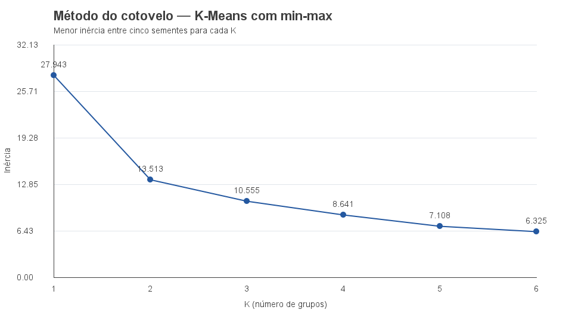

# Resultados da integração — 18/11/2026

Estes arquivos são snapshots reais da execução completa de `TrabalhoFinal todos`, depois de uma compilação do código integrado. Os testes foram executados em sequência antes da aplicação completa. Não foram incluídos materiais particulares do Classroom nem dados locais de autenticação.

- `execucao.txt`: saída das três consultas do Samuel, experimentos do KNN, jogador novo e resumos de K-Means. O caminho local da pasta de saída foi substituído por um caminho relativo.
- `knn`: seis CSVs, incluindo os erros e sua distribuição para a Parte E.
- `kmeans`: nove CSVs e um PNG para a Parte C.
- `validacao.json`: quantidade de verificações, sementes/iterações e resumo da conferência independente.

Foram cinco sementes por configuração, com limite de 100 iterações. Todas convergiram; a maior quantidade observada foi 15. O gráfico representa somente o cenário normalizado, com a menor inércia de cada K entre as cinco tentativas.

O modelo principal do KNN teve 29 acertos e um erro. A matriz é:

| Real / previsto | CASUAL | REGULAR | RANQUEADO |
|---|---|---|---|
| CASUAL | 9 | 0 | 0 |
| REGULAR | 0 | 5 | 0 |
| RANQUEADO | 0 | 1 | 15 |

Para Samuel: `knn/erros.csv` inclui as quatro configurações. Filtre `euclidiana_normalizada` para analisar o modelo principal. `knn/distribuicao_erros.csv` resume esse modelo por perfil real; `previsoes.csv` também contém os acertos para comparação. Não foram escritas conclusões sobre padrões ou causas dos erros.

Para Risley: use `kmeans/cotovelo.png` no relatório junto com `cotovelo.csv`. Os centroides dos dois cenários estão na escala original, mesmo no arquivo de nome `centroides_normalizado.csv`. As inércias de cenários com escalas distintas não são diretamente comparáveis.

